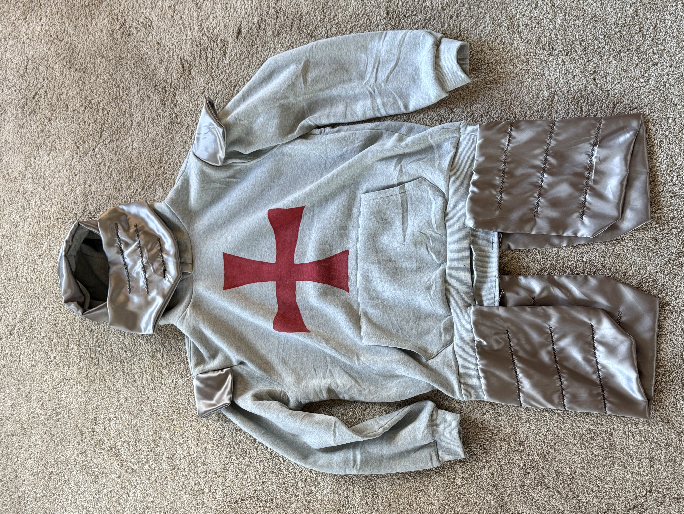
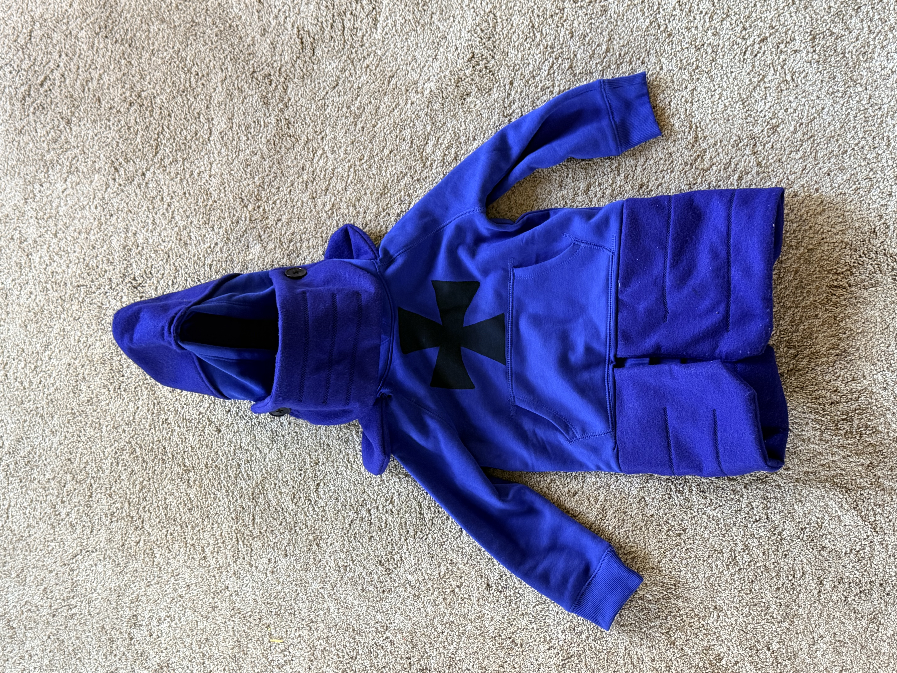
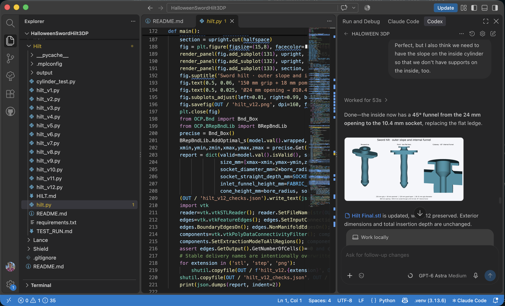
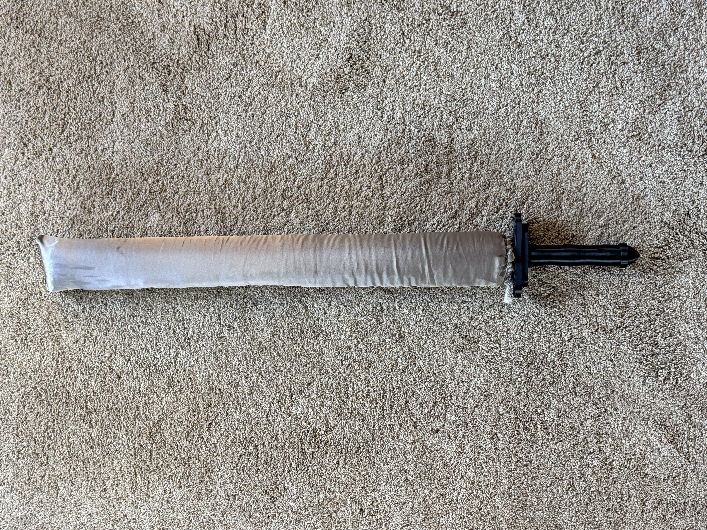
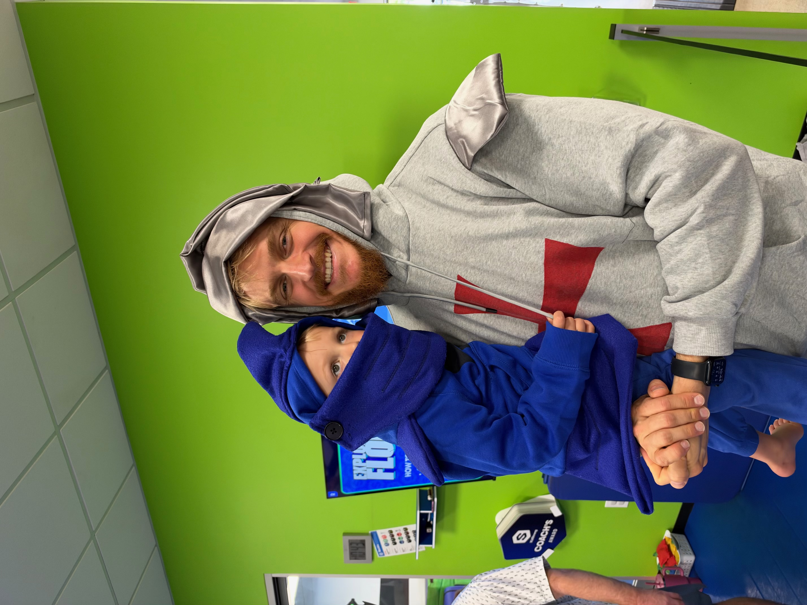

Each year I sew my own Halloween costume. This year, I think I made my best costume yet! I wanted to show it off and explain the process I went through to build it. So I'm making it the Project of The Month: Halloween Knights.

## Becoming the Halloween Knight

A few months ago my family went to [Medieval Times](https://www.medievaltimes.com/) to watch the knights joust. My son has been obsessed with knights ever since. Specifically he loves "blue knights" since we were in the blue section cheering for the blue knight. This obsession is cute, and we've been reinforcing it a lot. I even wrote him a book about [The Brave Blue Knight](https://shep4.com/shop/the-brave-blue-knight/) that we read together every night. Naturally, when Halloween came around we decided that we would be knights!

## Designing the Costume

Historically, all of my halloween costumes have a certain style to them: I start with a hoodie, then sew on felt attachments to it to turn it into a costume. I like this design because the costume is easy to make, comfortable to wear, and it's subtle enough that I can wear my costume in public without feeling too out of place.

For this year's Halloween Knight costumes, I did this same approach, starting with a grey hoodie for me and a blue hoodie for my son. Then I went to Hobby Lobby to buy some felt and shiny metallic fabric.

Compared to elaborate designs I have made in the past, it was extremely easy to convert my hoodies into knight costumes. I did this by converting the hood into a helmet with one long piece of fabric, then adding a moveable facemask using a button as an anchor. Then I just added shoulder pads, hip guards, and a big knight's cross to the chest. Overall it was an extremely simple design!

Check it out:

## Arming the Halloween Knights

No knight is complete without a sword! So I got to work as a blacksmith crafting our weapons.

The sword blade was a simple wooden stick padded with foam and then wrapped in metallic fabric. For the sword hilt, I ended up vibe coding the design in Claude using a python cad program and then 3D printing the final piece.

Let me explain how I made the hilt a little bit more because I myself was extremely impressed with how easy it was to make:

I literally just spent about an hour on Claude Code, telling it verbally, what the design should look like and how I would make it if I were doing the 3D modeling myself. Stuff like, "start with a cylinder for the grip, then add a long rectangular section for the crossguard...". Miraculously over a few iterations, Claude was able to translate my verbal instructions into a working 3D model that rendered as an STL file I could load into my Bambu printer.

All I needed to do after that was attach the blade to the hilt using yarn.

## The Final Look

Our costumes were a hit!

And best of all, the swords are functional for real combat!

<iframe width="560" height="315" src="https://www.youtube.com/embed/0NOnuaR76_k" title="Halloween Knights" frameborder="0" allow="accelerometer; autoplay; clipboard-write; encrypted-media; gyroscope; picture-in-picture" allowfullscreen></iframe>

## Conclusion

I'm extremely stoked about how the costumes turned out!

I'm also extremely excited for how easy it was to make a pretty complex 3D design using only text. This opens up a lot of possibilities for future costume and prop designs!